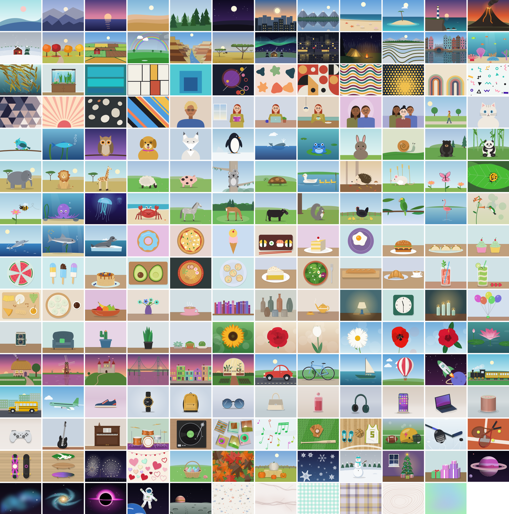

# bozzetto

Seeded placeholder images as tiny SVGs: landscapes, modern-art homages, people, animals, food and still lifes, each drawn from a handful of flat shapes and gradients, in any palette.

A _bozzetto_ is a painter's small preliminary sketch, made before the real work. These are the stand-ins for your real pictures.

**[Read the manual](https://mattputnam.github.io/bozzetto/)**, see [every kind](https://mattputnam.github.io/bozzetto/guide/kinds), or [make a palette](https://mattputnam.github.io/bozzetto/demo/picker.html).



- **Deterministic.** The same seed gives the same picture, everywhere. Seeds can be numbers or strings, such as a user id.
- **Small.** Most pictures are 2–8 KB as a data URI, and none needs a network request.
- **Any size and any palette.** Pictures are drawn to the size you ask for, in their own colors or yours.
- **No dependencies.** Import only the kinds you use and the rest is tree-shaken away.

## Install

```sh
npm install bozzetto
```

## Use

Every kind of picture is its own export, like icons in an icon library:

```ts
import { owl, toDataUri, toSvg } from "bozzetto";

img.src = toDataUri(owl, { seed: 3, size: "320x240" });
container.innerHTML = toSvg(owl, { seed: 3 }); // inline markup; element ids are unique per picture
```

To fill a gallery, `placeholders` makes a list. Most options take a single value or a list to go through picture by picture:

```ts
import { animals, donut, placeholders } from "bozzetto";

const photos = placeholders(24, {
  kind: [animals, donut], // every animal plus the donut
  size: ["400x300", "300x400", "300x300"], // mixed shapes
  palette: ["pastel", "riso"], // two looks
  seed: 1,
});
```

- **Lists are shuffled by default:** each value is used once, in a seeded order, before any repeats. Set `order: "cycle"` to go through them in the order given, or `order: "random"` for independent picks.
- **Picture k uses seed `seed + k`,** so asking for more pictures later keeps the first ones the same.
- **`numbered: true`** labels the pictures 1, 2, 3… in the corner.

`placeholder` makes a single picture, choosing a kind by seed when given a list. Both `placeholder` and `placeholders` bundle every kind; import kinds directly to keep a bundle small.

### Pictures

`placeholder`, `placeholders` and `render(kind, options)` return pictures with what a gallery needs:

```ts
for (const photo of placeholders(12, { kind: animals, size: ["400x300", "300x400"] })) {
  const img = new Image(photo.width, photo.height);
  img.src = photo.src; // a data URI; photo.svg is the markup, for inlining
  img.alt = photo.alt; // "A fox with dark-tipped ears", "An owl on a branch under a crescent moon"
  img.style.objectPosition = `${photo.focus.x * 100}% ${photo.focus.y * 100}%`;
  img.style.background = photo.color; // the main background color, shown while it loads
  gallery.append(img);
}
```

| Field             |                                                                                           |
| ----------------- | ----------------------------------------------------------------------------------------- |
| `src`, `svg`      | The picture as a data URI and as SVG markup                                               |
| `width`, `height` | Its size in px                                                                            |
| `kind`            | The id of the kind that drew it, such as `"owl"`                                          |
| `alt`             | A short description for screen readers. It never names colors, since palettes change them |
| `focus`           | The point of interest (a face, the sun) as fractions of the width and height              |
| `color`           | The main background color as `#rrggbb`                                                    |
| `options`         | The value each of the kind's options took                                                 |

`toSvg` and `toDataUri` return just the markup or the data URI, for when that's all you need.

## Command line

The `bozzetto` command writes pictures as SVG files, for fixtures, mockups and design tools:

```sh
npx bozzetto owl > owl.svg
npx bozzetto owl --seed 3 --size 320x240 --palette riso -o owl.svg
npx bozzetto animals donut -n 24 -s 400x300 -s 300x400 -o fixtures/
npx bozzetto landscapes -n 5 --format json
npx bozzetto --list
```

Name kinds by id (`ice-cream`), export name (`iceCream`) or category (`animals`), in any mix, and give a kind options after a colon: `cat:tabby,pupils=round`. The options match `placeholders`, and repeating `--size`, `--palette`, `--mapping` or `--texture` gives a list to go through. With several pictures, `-o <folder>` writes one SVG per picture plus `manifest.json` with each picture's kind, seed, size, alt text, focus and color. `--format png` writes PNGs (with `@resvg/resvg-js` installed), `--format uri` prints data URIs, one per line, and `--format json` prints everything, markup included. See `bozzetto --help` for the full list.

## Avatars

`avatar` frames a face around its head, round by default. Give it a user's id as the seed and each user keeps the same avatar:

```ts
import { avatar, avatars, portrait } from "bozzetto";

img.src = avatar({ seed: user.id, size: 48 }).src;
avatar({ seed: user.id, kind: portrait.with({ glasses: true }), shape: "rounded" });
avatars(20, { size: 64, palette: "pastel" }); // every face once before any repeats
```

The `faces` list holds the kinds that can be avatars: `portrait`, `cat`, `dog`, `fox`, `rabbit`, `owl`, `frog` and `penguin`. Shapes are `circle`, `rounded` and `square`, with transparent corners. React and Vue have an `<Avatar>` component, the web component takes an `avatar` attribute, and the command line has `--avatar`.

## React, Vue and web components

```tsx
import { Placeholder } from "bozzetto/react"; // or "bozzetto/vue"

<Placeholder kind="owl" seed={3} size="320x240" palette="pastel" loading="lazy" />;
```

```html
<script type="module">
  import "bozzetto/element";
</script>
<bozzetto-img kind="cat:tabby,pupils=round" seed="2" size="240x240"></bozzetto-img>
```

Each renders an `` with the picture's alt text and size, cropped around its focus, with its color showing while it loads. React and Vue also have `usePlaceholder` and `usePlaceholders`. React and Vue are optional peer dependencies; the web component needs nothing.

## PNG, WebP and JPEG

In the browser, `toImageBlob(picture, { type, scale, quality })` draws a picture on a canvas and returns a PNG, WebP or JPEG `Blob`. In Node, `toPng` from `bozzetto/node` renders PNGs with [resvg](https://github.com/yisibl/resvg-js), an optional dependency:

```ts
import { toPng } from "bozzetto/node"; // npm install @resvg/resvg-js

await writeFile("owl.png", await toPng(render(owl, { seed: 3 }), { scale: 2 }));
```

The command line writes PNGs with `--format png` (or an output file ending in `.png`) and `--scale`.

## Kinds

Categories are plain arrays of kinds. Use them anywhere a list of kinds is accepted, alone or mixed with single kinds, as in `[animals, donut]`.

| Category     | Kinds                                                                                                                                                                                                                                                                                                                                                                                    |
| ------------ | ---------------------------------------------------------------------------------------------------------------------------------------------------------------------------------------------------------------------------------------------------------------------------------------------------------------------------------------------------------------------------------------- |
| `landscapes` | `hills`, `mountains`, `sea`, `dunes`, `forest`, `night`, `city`, `lake`, `beach`, `island`, `lighthouse`, `volcano`, `winter`, `autumn`, `farm`, `rainbow`, `canyon`, `savanna`, `aurora`, `rainyStreet`, `campsite`, `terraces`, `canal`, `reef`, `kelp`, `aquarium`                                                                                                                    |
| `art`        | `field`, `grid`, `squares`, `orbits`, `cutouts`, `bauhaus`, `waves`, `dots`, `arches`, `confetti`, `triangles`, `sunburst`, `pebbles`, `stripes`                                                                                                                                                                                                                                         |
| `people`     | `portrait`, `reader`, `worker`, `cafe`, `pair`, `group`, `walker`                                                                                                                                                                                                                                                                                                                        |
| `animals`    | `cat`, `bird`, `fish`, `owl`, `dog`, `fox`, `penguin`, `whale`, `frog`, `rabbit`, `snail`, `bear`, `panda`, `elephant`, `lion`, `giraffe`, `sheep`, `pig`, `koala`, `turtle`, `duck`, `hedgehog`, `mouse`, `butterfly`, `ladybug`, `bee`, `octopus`, `jellyfish`, `crab`, `horse`, `deer`, `cow`, `squirrel`, `chicken`, `parrot`, `flamingo`, `hummingbird`, `dolphin`, `shark`, `seal` |
| `food`       | `donut`, `pizza`, `iceCream`, `sushi`, `cake`, `egg`, `burger`, `taco`, `cupcake`, `watermelon`, `popsicle`, `pancakes`, `avocado`, `ramen`, `cookies`, `pie`, `salad`, `bread`, `croissant`, `cocktail`, `smoothie`, `cheeseBoard`, `dumplings`                                                                                                                                         |
| `objects`    | `fruitBowl`, `flowers`, `coffee`, `books`, `bottles`, `teapot`, `lamp`, `clock`, `candles`, `balloons`, `camera`, `armchair`                                                                                                                                                                                                                                                             |
| `plants`     | `cactus`, `houseplant`, `succulents`, `sunflower`, `rose`, `tulip`, `daisy`, `poppy`, `hibiscus`, `lotus`                                                                                                                                                                                                                                                                                |
| `buildings`  | `cottage`, `windmill`, `castle`, `bridge`, `rowHouses`, `greenhouse`                                                                                                                                                                                                                                                                                                                     |
| `vehicles`   | `car`, `bicycle`, `sailboat`, `hotAirBalloon`, `rocket`, `train`, `bus`, `airplane`                                                                                                                                                                                                                                                                                                      |
| `products`   | `sneakers`, `watch`, `backpack`, `sunglasses`, `handbag`, `perfume`, `headphones`, `phone`, `laptop`, `speaker`, `controller`                                                                                                                                                                                                                                                            |
| `music`      | `guitar`, `piano`, `drums`, `record`, `cds`, `notes`                                                                                                                                                                                                                                                                                                                                     |
| `sports`     | `baseball`, `basketball`, `football`, `hockey`, `tennis`, `skateboard`, `surfboard`                                                                                                                                                                                                                                                                                                      |
| `holidays`   | `fireworks`, `hearts`, `eggBasket`, `fallLeaves`, `pumpkins`, `snowflakes`, `snowman`, `holidayTree`, `gifts`                                                                                                                                                                                                                                                                            |
| `space`      | `planets`, `nebula`, `galaxy`, `blackHole`, `astronaut`, `moon`                                                                                                                                                                                                                                                                                                                          |
| `patterns`   | `terrazzo`, `marble`, `gingham`, `plaid`, `topography`, `gradient`                                                                                                                                                                                                                                                                                                                       |

`kinds` lists every kind, and `categories` maps each category's name to its kinds. Kinds can also be named by id in strings, such as `"owl"` or `"ice-cream"`.

Some kinds have options, fixed with `kind.with(...)`. Whatever you leave out still varies with the seed, and fixing one option never changes the picture's other choices:

```ts
render(cat.with({ tabby: true, pupils: "round" }), { seed: 3 });
placeholders(8, { kind: [portrait.with({ glasses: true }), hills.with({ tree: true })] });
```

| Kind         | Options                                                                                                                        |
| ------------ | ------------------------------------------------------------------------------------------------------------------------------ |
| `hills`      | `tree`: `true`, `false`                                                                                                        |
| `night`      | `moon`: `"crescent"`, `"full"`                                                                                                 |
| `beach`      | `item`: `"umbrella"`, `"palm"`, `"shells"`                                                                                     |
| `dots`       | `pattern`: `"polka"`, `"halftone"`, `"scattered"`                                                                              |
| `portrait`   | `hair`: `"short"`, `"long"`, `"bun"`, `"curly"`, `"bald"`, `"bob"`; `glasses`: `true`, `false`; `smile`: `"gentle"`, `"broad"` |
| `walker`     | `place`: `"beach"`, `"park"`, `"hill"`; `dog`: `true`, `false`                                                                 |
| `cat`        | `tabby`, `muzzle`: `true`, `false`; `pupils`: `"slit"`, `"round"`                                                              |
| `bear`       | `coat`: `"brown"`, `"black"`, `"polar"`                                                                                        |
| `lion`       | `mane`: `true`, `false`                                                                                                        |
| `flamingo`   | `oneLeg`: `true`, `false`                                                                                                      |
| `dolphin`    | `scene`: `"leap"`, `"swim"`                                                                                                    |
| `seal`       | `perch`: `"rock"`, `"ice"`                                                                                                     |
| `pizza`      | `topping`: `"pepperoni"`, `"vegetable"`, `"margherita"`; `slices`: `6`, `8`                                                    |
| `lamp`       | `stand`: `"table"`, `"floor"`                                                                                                  |
| `cottage`    | `roof`: `"tiled"`, `"thatched"`                                                                                                |
| `windmill`   | `setting`: `"tulips"`, `"canal"`                                                                                               |
| `bridge`     | `style`: `"stone"`, `"suspension"`                                                                                             |
| `greenhouse` | `roof`: `"gable"`, `"arched"`                                                                                                  |
| `rocket`     | `scene`: `"launch"`, `"space"`                                                                                                 |
| `bus`        | `style`: `"city"`, `"school"`, `"double-decker"`                                                                               |
| `airplane`   | `engine`: `"jet"`, `"propeller"`                                                                                               |
| `guitar`     | `type`: `"acoustic"`, `"electric"`                                                                                             |
| `piano`      | `view`: `"upright"`, `"keys"`                                                                                                  |
| `record`     | `scene`: `"turntable"`, `"sleeve"`                                                                                             |
| `hockey`     | `headgear`: `"helmet"`, `"goalie"`                                                                                             |
| `skateboard` | `wall`: `"plaster"`, `"brick"`, `"wood"`, `"concrete"`                                                                         |
| `surfboard`  | `wall`: `"plaster"`, `"brick"`, `"wood"`, `"concrete"`                                                                         |
| `snowman`    | `hat`: `"top-hat"`, `"beanie"`, `"bowler"`                                                                                     |
| `astronaut`  | `tether`: `true`, `false`                                                                                                      |

## Colors

`palette` accepts:

- **An adjustment** of each picture's own colors: `"vivid"`, `"pastel"`, `"muted"`, `"dusk"`, `"dim"` or `"grayscale"`.
- **A built-in palette:** `"sunset"`, `"sea glass"`, `"riso"`, `"orchard"`, `"candy"`, `"sepia"` or `"mono"`.
- **Your own colors:** `["#264653", "#2a9d8f", "#e9c46a"]` (hex, `rgb()` or `hsl()`), or the same palette as a code, `"264653-2a9d8f-e9c46a"`.

Color palettes are applied with `mapping: "balanced"` by default, which uses only your exact colors while keeping each picture's light and dark. `"ramp"` blends between your colors for softer shading, and `"nearest"` snaps every color to its closest match. `texture: "grain"` or `"paper"` adds a subtle surface.

`dark: true` builds a dark-mode version into the picture: in dark mode it switches to it by itself, in an `` or inline, using the `dim` adjustment (everything darker, every hue kept), or any palette you give, as in `dark: "sea glass"`. For inline SVG on pages with their own theme switch, `darkSelector: "html.dark"` follows your selector instead of the system setting.

To build a palette without picking colors by hand, `makePalette` works from a starting color or hue and a color-wheel scheme:

```ts
import { makePalette, randomPalette } from "bozzetto";

makePalette({ base: "#e76f51", scheme: "triadic", count: 5, contrast: 0.7, vibrance: 0.55 });
makePalette({ base: 200, scheme: "analogous", locked: [null, "#123456"] }); // keep chosen colors in place
randomPalette("my-seed");
```

Schemes are `monochrome`, `analogous`, `complementary`, `split-complementary`, `triadic` and `tetradic`. Palettes are built in OKLCH, so their steps look even. `encodePalette` and `decodePalette` convert between a list of colors and a palette code.

## Options

| Option     | Default     |                                                                             |
| ---------- | ----------- | --------------------------------------------------------------------------- |
| `kind`     | every kind  | A kind, an id, or a list (`placeholder` and `placeholders`)                 |
| `size`     | `"400x300"` | `"WxH"` or `{ width, height }`                                              |
| `seed`     | `1`         | A number or string                                                          |
| `palette`  | none        | An adjustment, palette name, palette code, or list of colors                |
| `mapping`  | `balanced`  | How a color palette is applied: `balanced`, `ramp` or `nearest`             |
| `texture`  | none        | `grain` or `paper`                                                          |
| `label`    | none        | Text in the bottom-right corner (single pictures)                           |
| `numbered` | `false`     | Label pictures 1, 2, 3… (`placeholders`)                                    |
| `order`    | `shuffle`   | How lists are gone through: `shuffle`, `cycle` or `random` (`placeholders`) |

In `placeholders`, `kind`, `size`, `palette`, `mapping` and `texture` each take a single value or a list. A list made only of colors counts as one palette: `["#264653", "#e76f51"]` is one palette, while `["pastel", "riso"]` is two.

### Your own kinds

A kind is a function from a seeded random source and a size to the markup inside `<svg>`. It can also describe what it drew, with `note.alt(text)`, and point out its focus, with `note.focus(x, y)`:

```ts
import { defineKind, placeholders, render, toDataUri } from "bozzetto";

const dot = defineKind(
  "dot",
  "Dot",
  (r, w, h) =>
    `<rect width="${w}" height="${h}" fill="#eee"/><circle cx="${r.f(0, w)}" cy="${r.f(0, h)}" r="20" fill="tomato"/>`,
);

img.src = toDataUri(dot, { seed: 1, palette: "riso" });
render(dot).alt; // "A single dot on a plain ground"; without note.alt it would be the kind's name, "Dot"
placeholders(6, { kind: [dot, "owl"] }); // custom kinds mix with built-in ones
```

`r` has `f(min, max)`, `i(min, max)`, `pick(list)`, `chance(p)`, `next()`, and `id(name)` for gradient and mask ids that stay unique when several pictures are inlined on one page.

## Stability

Pictures are part of the API. Within a major version, the same kind, seed, size and options always draw the same picture with the same alt text, and kind ids, options and categories are never renamed or removed. Minor versions can add kinds: a new kind takes its fair share of the seeds that choose from a list it joins (about one in however many kinds the list holds) and leaves every other seed's pick alone. Choose from your own list of kinds to keep every pick fixed. Redrawing a kind needs a new major version. The [stability guide](https://mattputnam.github.io/bozzetto/guide/stability) has the details.

## Develop

```sh
npm install
npm run dev       # the gallery and palette picker, at /index.html and /picker.html
npm run build     # the library and the bozzetto command, in dist/
npm run check     # format check, lint, typecheck and tests
npm run pages     # self-contained copies of the demo pages in demo/out/
npm run gallery   # regenerate media/gallery.svg
npm run docs:dev  # the manual, with live examples (docs:build builds the whole site, as GitHub Pages does)
```

The source is laid out by job:

| Folder            |                                                                                                |
| ----------------- | ---------------------------------------------------------------------------------------------- |
| `src/kinds/`      | One folder per category and one file per kind, with helpers several kinds share in `shared.ts` |
| `src/draw/`       | What kinds draw with: `defineKind`, the seeded `Rand`, SVG helpers, shapes and alt-text words  |
| `src/color/`      | Color math, palettes, styling and dark mode                                                    |
| `src/render/`     | Rendering a kind to a picture, choosing kinds, avatars and raster images                       |
| `src/frameworks/` | The React, Vue and web components                                                              |
| `src/node/`       | `bozzetto/node`: PNGs through resvg                                                            |
| `src/cli/`        | The `bozzetto` command                                                                         |

Every kind is marked pure, and `test/tree-shaking.test.ts` checks that an app importing one kind
leaves the others out.

## License

MIT
